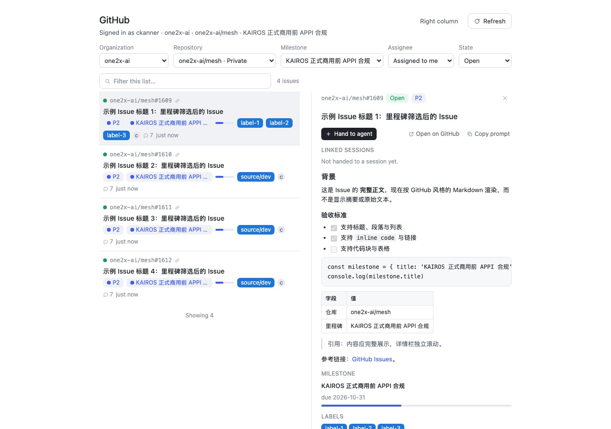

# dsh-plugin-github-issues

English | [中文](docs/README.zh.md)

[](https://github.com/ckanner/dsh-plugin-github-issues/actions/workflows/ci.yml)
[](https://github.com/ckanner/dsh-plugin-github-issues/actions/workflows/release.yml)
[](https://www.npmjs.com/package/dsh-plugin-github-issues)
[](LICENSE)

Adds a GitHub Issues work surface to [DeepSeek Harness](https://github.com/deepseek-ai/deepseek-harness):
browse issues from your repositories, read their details, and hand one to the
agent. A handoff opens a new Session in the matching Workspace and stages the issue as an
attachment-style card inside the composer; sending turns that card into the issue's task prompt.
Handed-over issues show which Sessions own them, can be entered, and can be unlinked; one issue may be
worked in several Sessions.



It is **read-only**: the plugin never writes to GitHub.

## Install

From the npm registry (recommended — the package ships the built Host half and browser bundle):

```sh
dsh plugin --profile <name> add dsh-plugin-github-issues
```

Pin a version when you want reproducible profiles:

```sh
dsh plugin --profile <name> add dsh-plugin-github-issues@0.4.7
```

Restart the harness afterwards: a profile is composed at startup. Remove it with:

```sh
dsh plugin --profile <name> remove dsh-plugin-github-issues
```

From a checkout (a linked install: rebuild and restart after edits):

```sh
npm install
npm run build
dsh plugin --profile <name> add /path/to/dsh-plugin-github-issues
```

Every [release](https://github.com/ckanner/dsh-plugin-github-issues/releases) also carries a packed
tarball (`dsh-plugin-github-issues.tgz`), installable by path.

## Requirements

- DSH Desktop with a Web GUI (developed and verified against `0.2.1-rc.3`).
- A [`gh`](https://cli.github.com/) CLI logged in for the GitHub host you use:
  `gh auth login`. The token stays in the OS keychain and is never written into this package's config.
- The panel is repository-scoped: pick an organization and a repository (a default is selected for
  you), then narrow by milestone, assignee and state.

## What you get

| Surface | Where | What |
|---|---|---|
| GitHub panel | left rail icon → main panel | organization → repository → **milestone** → assignee → state cascade (remembered across restarts) in one fixed toolbar; a default organization/repository is selected for you, the milestone dropdown lists only that repository's milestones, and only the list scrolls (search stays above it, the detail pane scrolls independently with the **full issue body rendered as sanitized GitHub-flavored Markdown**, milestone progress, labels, priority, assignees, linked/mentioned PRs and checks) |
| Issues right column | right sidebar tab | the same filtered issue list beside the Conversation, for drag-and-drop handoff |
| Composer card | inside the input box | the staged issue: `[GitHub] owner/repo#number ×`. Type extra instructions or nothing; send converts the card into the issue prompt |
| Linked chip | composer dock under the input | the Session's linked issue: state dot (green open / red closed) + `owner/repo#number`; click for a detail popover, remove to unlink |
| Handoff actions | issue detail | one-click **enter Session** (latest link), **new Session for this issue**, plus a linked-Session list with per-Session enter/unlink |
| GitHub settings | Settings → GitHub | `gh` auth status and scopes, handoff behavior, prompt template |

## Use

1. Click the **GitHub** icon in the left rail.
2. Pick an organization and a repository (the first one is selected automatically), then a milestone,
   assignee and state. The selection is remembered in the profile's UI state (not in the plugin
   config).
3. Click a row for the detail pane. `owner/repo#number` opens GitHub in the browser.
4. Hand an issue over:
   - **One-click** in the detail: **Hand to agent** / **New session for this issue** opens a new
     Session in the matching Workspace with the issue staged inside the composer.
   - **Drag** a row from the right-column **Issues** tab into the composer: it stages into the current
     Session.
   - Type whatever context you want, then send. The card is converted into the issue's task prompt
     (the template from Settings) plus your text; the issue ↔ Session link is recorded at that moment.
5. The linked chip appears under the composer. Reopen the issue later to enter that Session, start
   another one, or unlink it. Unlinking never deletes the Session.
6. Open the right column from the panel header (**Right column**) or from the right sidebar's own add
   menu (page type **Issues**).

### Which Session does a handoff use?

- If the issue is already linked: **enter Session** opens the most recent link; the linked-Session list
  lets you enter any of them.
- A new handoff picks a Workspace by this priority: the Workspace of the current Session → the
  Workspace of a Session already linked to the same repository → a Workspace whose directory/title
  matches the repository name → the Host's current/most-recent Workspace.

### Prompt template

Settings → GitHub → Prompt template. Variables: `{{repo}}`, `{{number}}`, `{{title}}`, `{{url}}`,
`{{state}}`, `{{milestone}}`, `{{priority}}`, `{{assignees}}`, `{{labels}}`, `{{prs}}`.

## Privacy and tokens

- The token is resolved by the Host process from `gh` and lives only in memory. It never reaches the
  page, the plugin config, or logs.
- GitHub requests are made by the Host; the browser only receives view models.
- Persisted UI state is limited to filter preferences, the prompt template, and issue ↔ Session links,
  stored at `$DSH_HOME/github-issues/state.json` (mode `0600`).
- The plugin is read-only toward GitHub.

## Limitations

- Read-only: no comments, label/assignee/state writes.
- The list uses the repository's exact `issues` connection, so state, assignee and milestone filters
  are applied by GitHub (and the total is authoritative); milestone filtering sends the milestone
  number through `filterBy.milestoneNumber`.
- The detail body is the complete issue body, rendered with Markdown (headings, lists, code blocks,
  tables, links, images) and sanitized before display; it is not an excerpt and it is not capped to a
  small fixed-height box.
- Milestone choices come from the selected repository's full milestone list (open and closed).
- Priority falls back organization Issue Field → `P0`–`P4` labels when no project field is present.
- The list polls every 60–120 s while visible; use **Refresh** for an immediate update.
- The detail pane first asks for the body only and lazily loads cross-referenced PRs, so the slow
  timeline never blocks the pane.
- Converting the composer card into the prompt intercepts the native send button / Enter, which relies
  on the composer DOM of the verified DSH version; re-check after a DSH upgrade.
- Workspace matching for a new handoff is the heuristic priority above, not a fixed mapping.

## Development

```sh
npm install
npm run typecheck      # Host + browser halves
npm test               # node --test (queries, VM mapping, prompt, state, workspace rules)
npm run test:render    # offline react-dom/server smoke of the panel, dock, sidebar, drop target
npm run build          # Host (tsc) + browser bundle (esbuild)
npm run verify:client  # loader contract + slot/Remote registration of the browser bundle
npm run verify:package # what npm publish would ship (host, client, bundle patch, locale, icon)
npm run check          # all of the above, in order
```

## Releases

`ci.yml` runs on every push and pull request. `release.yml` runs on a `v*` tag (or by hand): it repeats
every CI check, publishes the new version to npm (a repository `NPM_TOKEN` secret, or npm trusted
publishing), and records a GitHub Release carrying `dsh-plugin-github-issues.tgz`. Maintainer notes:
[docs/RELEASING.md](https://github.com/ckanner/dsh-plugin-github-issues/blob/main/docs/RELEASING.md).

## License

MIT © Kanner
